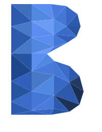

<div align="center">



# Network Capture Extension

### Captura cada petición de red de una pestaña y exporta la sesión completa en ZIP, JSON, HAR o CSV.

[](https://developer.chrome.com/docs/extensions/mv3/intro/)
[](https://www.google.com/chrome/)
[](LICENSE)
[](#arquitectura)

**Producto de [BuenaIA](https://github.com/BuenaIA)**

</div>

---

## Qué resuelve

Las DevTools de Chrome muestran las peticiones de red mientras las tienes abiertas; al cerrarlas, la información se pierde. Los exports HAR no incluyen los cuerpos de respuesta y las extensiones típicas solo ven cabeceras. Network Capture Extension graba la sesión completa, con cuerpos incluidos, y la entrega en un paquete que se puede compartir: un informe de incidencia, una prueba para QA o una colección para Postman.

## Características

| | |
|---|---|
| 📡 **Captura de petición** | URL, método, cabeceras, cookies, parámetros de consulta, cuerpo POST (en bruto y parseado), iniciador, frame y tipo de recurso |
| 📥 **Captura de respuesta** | Estado, cabeceras, `Set-Cookie` parseadas, MIME, IP y puerto remotos, tiempos y **cuerpo de respuesta** (texto o binario en base64) |
| 🎛️ **Controles en directo** | Start, Pause, Resume, Stop y Clear, con contador de peticiones, bytes y tiempo transcurrido |
| 📦 **Exportación** | **ZIP** (paquete completo con `index.html` navegable), **JSON**, **HAR** 1.2 y **CSV** |
| 🔍 **Filtros** | Por URL, método, estado, MIME o tipo de recurso; los mismos filtros en popup y panel |
| 🪟 **Tres interfaces** | Popup compacto, panel de pantalla completa y pestaña dentro de DevTools |
| 🍪 **Herramientas del sitio** | Borrar cookies y caché solo del origen capturado |
| 💾 **Resistente a reinicios** | Las peticiones se persisten en `chrome.storage.local`; una captura larga sobrevive a que Chrome duerma el service worker |
| 🔒 **Local por diseño** | Sin llamadas de red, sin analítica y sin dependencias externas |

## Instalación

Requisitos: Google Chrome 116 o superior (o Edge, Brave y otros navegadores basados en Chromium).

Hay dos formas de instalarla. Ambas terminan en el mismo paso de carga manual, porque la extensión no está en la Chrome Web Store.

### Opción A: descargar el ZIP (recomendada para usuarios)

1. Ve a [Releases](https://github.com/BuenaIA/network-capture-extension/releases) y descarga `network-capture-extension-v1.0.0.zip` desde la última versión.
2. **Descomprime el ZIP** en una carpeta fija, por ejemplo `Documentos/network-capture-extension`. Chrome no puede cargar el `.zip` directamente, y la carpeta tiene que quedarse ahí: si la borras o la mueves, la extensión deja de funcionar.
3. Abre `chrome://extensions` en Chrome.
4. Activa **Modo de desarrollador** (interruptor arriba a la derecha).
5. Pulsa **Cargar descomprimida** y selecciona la carpeta descomprimida (la que contiene `manifest.json`, no una carpeta anidada dentro de ella).
6. Fija la extensión en la barra de herramientas (icono del puzzle → 📌).

Para actualizar: descarga el ZIP de la nueva versión, sustituye el contenido de la carpeta y pulsa el icono ↻ en la tarjeta de la extensión en `chrome://extensions`.

### Opción B: clonar el repositorio (para desarrolladores)

1. Clona el repositorio:
   ```bash
   git clone https://github.com/BuenaIA/network-capture-extension.git
   ```
2. Abre `chrome://extensions` y activa **Modo de desarrollador**.
3. Pulsa **Cargar descomprimida** y selecciona la carpeta clonada.
4. Fija la extensión en la barra de herramientas.

Para actualizar con `git pull`, pulsa ↻ en la tarjeta de la extensión; si no, seguirás ejecutando una mezcla de código antiguo y nuevo.

> **Aviso:** Chrome muestra periódicamente el mensaje «Desactiva las extensiones en modo de desarrollador» al abrir el navegador. Es normal; pulsa **Cancelar** para mantener la extensión activa.

## Uso

1. Abre el sitio que quieres inspeccionar.
2. Pulsa el icono de la extensión y después **Start**. Chrome mostrará una barra amarilla indicando que la pestaña está siendo depurada; es obligatoria para usar el Chrome DevTools Protocol y no debe cerrarse durante la captura.
3. Navega por el sitio con normalidad.
4. Pulsa **Stop** y después **⬇ ZIP** (o JSON, HAR o CSV).

Para revisar una captura:

- **ZIP:** descomprímelo y abre `index.html` en el navegador.
- **HAR:** ábrelo en las DevTools, Postman, Charles o Insomnia.
- **CSV:** ábrelo en Excel u hojas de cálculo.
- **JSON:** `all_requests.json` es procesable con `jq`, Python o Node.

<details>
<summary><b>Estructura del ZIP exportado</b></summary>

```
network_capture_<fecha>.zip
├─ index.html              ← resumen navegable
├─ summary.json            ← metadatos de la captura (inicio, fin, bytes, pestaña)
├─ all_requests.json       ← todas las peticiones en un único archivo
├─ capture.har            ← HAR 1.2
├─ capture.csv            ← resumen para hojas de cálculo
├─ counter_and_time.txt   ← contador y tiempos legibles
├─ requests/              ← un JSON por petición, con todos los datos
├─ bodies/                ← cuerpos de respuesta con la extensión correcta
├─ post_data/             ← cuerpos de POST/PUT en bruto
└─ cookies/
    ├─ request_cookies.json   ← cookies enviadas, con URL de origen
    └─ response_cookies.json  ← cada Set-Cookie, parseada en campos
```

</details>

## Casos de uso

- **Incidencias técnicas:** adjunta la captura para que el equipo reproduzca la sesión exacta.
- **Ingeniería inversa de APIs:** cabeceras, parámetros y cookies no documentados.
- **Pruebas de API:** exporta a HAR e impórtalo en Postman.
- **Depuración de autenticación:** revisa cada `Set-Cookie` y los problemas de `SameSite`.
- **Análisis de rendimiento:** tiempos y tamaños por petición en el CSV.
- **Auditoría de seguridad:** qué envía y recibe un sitio, solo en pruebas autorizadas.

## Privacidad y permisos

Los datos no salen del equipo. El código no contiene ninguna llamada de red (`fetch`, `XMLHttpRequest`, `WebSocket` ni `sendBeacon`) hacia otros destinos, así que cualquiera puede verificarlo auditando el código fuente.

| Permiso | Motivo |
|---|---|
| `debugger` | Única vía para leer los cuerpos de respuesta (Chrome DevTools Protocol) |
| `<all_urls>` | Permite adjuntar el depurador a la pestaña que se captura |
| `storage` | Persiste las peticiones entre reinicios del service worker |
| `downloads` | Guarda los archivos ZIP, JSON, HAR y CSV |
| `tabs`, `activeTab` | Identifica la pestaña capturada |
| `cookies` | Lee metadatos de cookies del sitio capturado |
| `browsingData` | Botones de borrado de cookies y caché por origen |
| `offscreen` | Construye los blobs de exportación (el service worker de MV3 no puede crearlos) |
| `webNavigation`, `scripting` | Declarados pero no usados en la versión actual |

## Arquitectura

Vanilla HTML, CSS y JavaScript, sin frameworks, bundler ni paso de compilación. Todo el código de la extensión ronda las 1.400 líneas de JS.

```
.
├─ manifest.json          ← manifiesto MV3: permisos y puntos de entrada
├─ background.js          ← service worker: captura CDP, persistencia y descargas
├─ offscreen.html / .js   ← construye los blobs ZIP, JSON, HAR y CSV
├─ zip.js                 ← escritor ZIP propio (método STORE, sin compresión)
├─ popup.html / .css / .js ← UI compacta de la barra de herramientas
├─ panel.html / panel.js  ← panel de pantalla completa con pestañas de detalle
├─ devtools.html / .js    ← registra la pestaña dentro de DevTools
├─ assets/                ← identidad visual BuenaIA
└─ wiki/                  ← documentación detallada (fuente de la wiki del repo)
```

Documentación detallada en [`wiki/`](wiki/Home.md): instalación, guía de uso, formatos de exportación, solución de problemas y guía para desarrolladores.

## Preguntas frecuentes

<details>
<summary><b>¿Por qué aparece una barra amarilla en la pestaña?</b></summary>

Es el aviso obligatorio de Chrome cuando una extensión usa `chrome.debugger`. No se puede ocultar. La captura se detiene si se cierra esa barra.
</details>

<details>
<summary><b>¿Puedo tener las DevTools abiertas durante la captura?</b></summary>

No. Chrome permite un único cliente depurador por pestaña. Captura sin DevTools abiertas o usa la pestaña **Network Capture** dentro de DevTools.
</details>

<details>
<summary><b>¿Ralentiza la página?</b></summary>

La sobrecarga es la misma que la del panel Network de DevTools y normalmente no se nota.
</details>

<details>
<summary><b>¿Qué pasa con respuestas muy grandes?</b></summary>

Chrome no devuelve cuerpos de respuesta muy grandes a través de CDP. Esas peticiones se registran con un campo `responseBodyError`. Las cabeceras, cookies y tiempos siempre se capturan.
</details>

<details>
<summary><b>El popup dice "Stale SW — reload extension!". ¿Qué hago?</b></summary>

Has actualizado el código sin recargar el service worker. Ve a `chrome://extensions` y pulsa el icono ↻ de la extensión.
</details>

<details>
<summary><b>¿Puedo capturar varias pestañas a la vez?</b></summary>

Por ahora, una pestaña cada vez.
</details>

## Hoja de ruta

- [ ] Modo de captura automática al abrir una pestaña
- [ ] Captura simultánea de varias pestañas
- [ ] Generador de fragmentos cURL, fetch y Python `requests` por petición
- [ ] Reproducción de una petición desde el panel
- [ ] Compresión gzip opcional en el escritor ZIP
- [ ] Visor de capturas guardadas
- [ ] Lista de inclusión y exclusión de URLs
- [ ] Tema claro y oscuro

## Contribuir

Repositorio privado de BuenaIA. Para cambios grandes, abre primero una incidencia para acordar el diseño.

```bash
git clone https://github.com/BuenaIA/network-capture-extension.git
# Carga la carpeta descomprimida en chrome://extensions
# Edita el código y pulsa ↻ en la tarjeta de la extensión
```

## Licencia y origen

Distribuido bajo **GNU GPL v3.0**. Consulta [LICENSE](LICENSE).

Este proyecto parte de [network-capture-pro-chrome-extension](https://github.com/Mahdi-hasan-shuvo/network-capture-pro-chrome-extension) (commit `bbfa36f`), publicado bajo GPL-3.0. El historial de este repositorio empieza con esa importación. Las modificaciones posteriores son de BuenaIA.

Si distribuyes una versión modificada, debes publicar su código fuente bajo GPL-3.0.

---

<div align="center">

**Network Capture Extension** · Desarrollado por [BuenaIA](https://github.com/BuenaIA)

</div>
